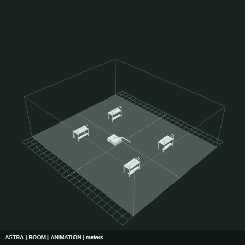
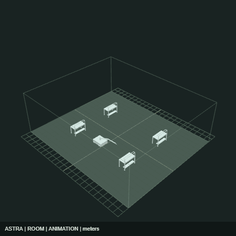

# Open-weight vs closed-source scene-authoring smoke test

**Can a small open-weight LLM generate an importable, animated 3D scene as reliably as a closed-source model?** This hackathon prototype runs Qwen3 4B and GPT-4.1 through Comfy Cloud, validates their unedited JSON, and renders both in OpenIndustries.

| Qwen3 4B | GPT-4.1 |
| --- | --- |
|  |  |

## Run the interactive viewer

Requires Node.js 22.14+ and an OpenIndustries checkout with its dependencies installed. Clone both repositories into the same parent directory:

```sh
git clone https://github.com/Mapped-Assembly/OpenIndustries.git Open-Industries
cd Open-Industries
git checkout 5e306c2033bfdb15510f98f575f937e1578f6a3f
npm ci
cd ..
git clone https://github.com/isayahc/openindustries-llm-comparison.git
cd openindustries-llm-comparison
npm ci
npm start
```

Open **http://127.0.0.1:4194/comparison**. Switch models, orbit/zoom, scrub the full 20-second animation, or download a portable scene. Viewing the saved outputs needs no Comfy account or API credentials. `OI_ROOT` can point to a different OpenIndustries checkout; `PORT` overrides the viewer port.

## Results and methodology

Both models ran on Comfy Cloud with the same prompt (`prompt.txt`) and 4096-token output caps. No model answer was repaired. One task and one sample per model: this demonstrates the pipeline, not a general model ranking or autonomous tool calling.

| Result | Qwen3 4B (open weight) | GPT-4.1 (closed source) |
| --- | --- | --- |
| Strict JSON and OpenIndustries schema | Pass | Pass |
| Structural/task checks including portable roundtrip | 13/13 | 13/13 |
| Browser import | 5 objects, no missing geometry | 5 objects, no missing geometry |
| Compact JSON instruction | Pretty-printed instead | Followed |
| Bed labels | Grow Bed A–D | Lettuce, Herb, Tomato, Microgreens |
| Robot Z path at 0/5/10/15/20 seconds | -4, -2, 2, 4, -4 | -4, -2, 4, -2, -4 |

Qwen uses `qwen_3_4b.safetensors` through CLIPLoader (`ltxv`) and TextGenerate, sampling off, thinking false, default template enabled. GPT-4.1 uses OpenAIChatNode with OpenAIChatConfig, truncation disabled, provider sampling defaults. These wrappers/settings are not identical inference implementations. `/no_think` was included in both prompts. GPT-4.1 has no reasoning mode; Qwen was deliberately tested without thinking.

Both satisfy the required endpoints, aisle, and loop. Constant speed was not requested; Qwen's final segment is 1.6 m/s vs GPT-4.1's maximum 1.2 m/s. Neither result is a physical-control or collision certification. Names/creativity are qualitative observations, not part of the 13 checks.

## Artifacts

- `*.raw.txt`: original unedited answers.
- `*.scene.json`: portable scene with existing example geometry bundled by a deterministic adapter. Open in OpenIndustries using Import project. The adapter maps field names and adds track/key IDs without changing model choices.
- `*.png`: screenshots after real browser import at 1440×1000.
- `*.gif`: native OpenIndustries authored-animation render, 480×480, 40 frames at 10 fps. These show **seconds 8–12** of the original 20-second timeline, because the native GIF renderer limits each clip to four seconds. They are not full-loop exports.
- `*.gif-metadata.json`: exact per-frame world poses and provenance.
- `results.json`: individual checks, job IDs, speeds, and browser evidence.
- `evaluate.mjs`: reruns validation, portable conversion, browser import, and GIF capture without making paid model calls.

The pinned OpenIndustries checkout retains legacy `astra.scene` serialization and Mergence UI branding. Its supported parser and scene contract were used directly. The farm is a planning layout: existing cleanroom desks stand in for grow beds, and the bundled robot is reused. Models generated the scene arrangement/animation, not new geometry. See [source attribution and geometry notices](PROVENANCE.md).

## Reproduce validation and rendering

Google Chrome must be installed for the browser checks. From this repository:

```sh
npm run evaluate
```

This validates the saved answers, regenerates the portable scenes, imports each in a fresh browser, and exports screenshots/GIFs. It starts a temporary local Vite server on port 4195 and shuts it down when finished. It does not call a model or spend credits.

## Repeat model generation through Comfy MCP

`npm run workflows` regenerates the two `*.workflow-api.json` files from the shared prompt. These are **API-format** graphs for `submit_workflow` or two `submit_batch` items with `tool: "submit_workflow"`, not editor drag-and-drop files. They correspond to the node graphs used in this run. Both use `SaveText` to preserve the raw answer. Submit through an authenticated Comfy Cloud MCP connection, wait for the jobs, and download their outputs. New generations consume Comfy credits.

To evaluate a new run, replace the corresponding `*.raw.txt` files and update the job identifiers in `evaluate.mjs`, then rerun the evaluator. Keep separate copies for multiple trials. The recorded run is a single-sample smoke test, not a statistical benchmark.

The two paid generation jobs have already completed; their IDs are in `results.json`. No provider keys or signed download URLs are stored here.
