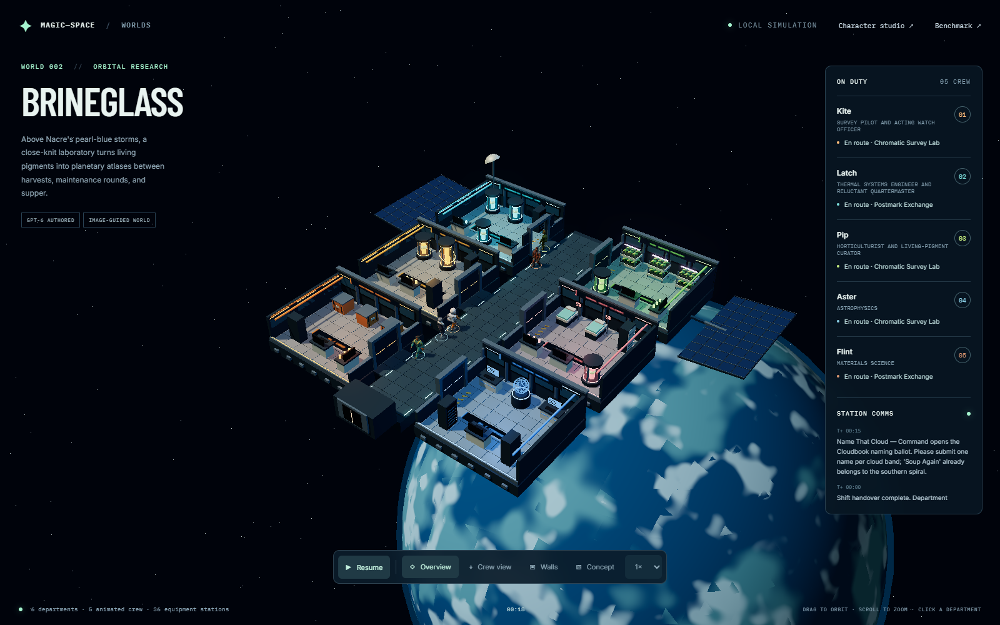
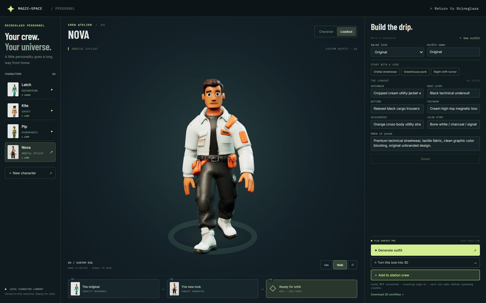

# Magic-Space

**From generated concepts to inhabited 3D worlds.** Explore **Brineglass**, an original Space Station 13–inspired orbital laboratory: six departments, 36 equipment stations, sliding airlocks, and three rigged crew following GPT-6-authored routines. Nano Banana Pro created the visual brief; GPT-6 Astra received that image and authored the station blueprint.



[Watch the walking crew (WebM)](assets/station/crew-walking.webm) · [Crew close-up](assets/station/crew-close.png) · [Concept art](assets/station/concept.png) · [Original GPT-6 blueprint](assets/station/blueprint.raw.txt)

**New: the character atelier.** Start from a default crew member, design their outfit with image-to-image editing, and turn the approved look into a rigged 3D crewmate. Open `/characters` to try the included **Nova** sample, created with **FLUX Kontext Pro → Tripo P2 → biped rig → walk/idle**.



The separate benchmark asks: **Can an open-weight LLM generate an importable, animated 3D scene as reliably as a closed-weight model?** It compares **DeepSeek-V4-Pro and GPT-6 Astra** through Comfy Cloud, validates their unedited JSON, and renders both in OpenIndustries.

| DeepSeek-V4-Pro · open weight | GPT-6 Astra · closed weight |
| --- | --- |
|  |  |


[View the demo locally](#run-locally) · [Install OpenCode + Comfy MCP](#install-opencode--comfy-mcp) · [Run smoke tests](#smoke-tests)

## Why care?

**Generating an asset is only the beginning. Magic-Space explores how to bring it to life in a world.**

Stable Diffusion can generate visual concepts, and dedicated 3D-generation models can produce meshes. OpenIndustries adds a shared space: named objects, real-world placement, editable scene data, and authored motion. In this demo, the LLMs arrange existing geometry and animate a robot; **Tripo P2** generates the new astronaut, engineer, and botanist meshes.

For game designers, the next step is **persistent world context**: retain object identities, layout, roles, and previous decisions so a new generation can extend a world without losing continuity. The current prototype preserves serialized scenes and an offline station blueprint with repeating crew routines; cross-generation continuity and live LLM decision-making are future work.

## Hackathon checklist

- [x] Create and publish the GitHub repository.
- [x] Document how to run the codebase locally.
- [x] Run an open-weight vs. closed-weight model comparison.
- [x] Include GIFs and screenshots of sample outputs.
- [ ] Record a walkthrough video of the generation-to-world workflow.
- [x] Add video clips of sample outputs alongside the GIFs.
- [ ] Carry world context across generations to help game designers maintain continuity.

## Tools used

| Tool | Role |
| --- | --- |
| **Comfy MCP** (`comfy-cloud`) | Run LLM workflows on Comfy Cloud and retrieve their outputs. The local `comfy-mcp` connection is optional and was not used for these generations. |
| **DeepSeek-V4-Pro — open-weight** | Generate scene layout and animation as JSON through Comfy's OpenRouter LLM node. Hosted inference; weights are not run locally. |
| **GPT-6 Astra — closed-weight** | Generate the comparison scene, plus the image-conditioned Brineglass blueprint and crew routines. |
| **Nano Banana Pro** | Generate the station concept image supplied to GPT-6. |
| **FLUX Kontext Pro / Black Forest Labs** | Edit a default character reference into a new coordinated outfit. |
| **Tripo P2 + rig/retarget nodes** | Generate textured crew GLBs; a new station crew has biped skeletons and walk/idle clips. |
| **Comfy Cloud MCP through OpenCode** | Character generation through your existing sign-in, persisted job IDs, result collection and local asset storage. |
| **Three.js** | Build the station from reusable procedural architecture and props; execute navigation and skeletal animation. |
| **OpenIndustries / its MCP scene contract** | Validate scene structure, resolve existing assets, import portable projects, and render animation. This run uses its schema and libraries directly; an autonomous OpenIndustries MCP tool loop is future work. |
| **OpenCode** | Coordinate model calls, write the adapter/evaluator, and package the demo. |
| **Playwright + Chrome** | Verify real browser imports and capture screenshots; GIFs use OpenIndustries’ renderer. |

## Run locally

### 1. Install prerequisites

- **Git** and **Node.js 22.14+** (including npm).
- A browser for the viewer. **Google Chrome** is required only for `npm run evaluate`.
- No local GPU, Python, ComfyUI installation, or API credentials are needed to view and evaluate the saved outputs.

### 2. Clone and install

Run these commands in a terminal. They work in PowerShell, macOS, and Linux shells. Keep both repositories in the same parent directory; the pinned OpenIndustries commit matches the recorded demo.

```sh
git clone https://github.com/Mapped-Assembly/OpenIndustries.git Open-Industries
cd Open-Industries
git checkout 5e306c2033bfdb15510f98f575f937e1578f6a3f
npm ci
cd ..
git clone https://github.com/isayahc/Magic-Space.git
cd Magic-Space
npm ci
npm start
```

### 3. Open the 3D space

Open **http://127.0.0.1:4194/station** and leave the terminal running.

- Drag to orbit, scroll to zoom, and click a department to inspect its equipment.
- Click a crew card or **Crew view** to follow a walking character; **Overview** resets the camera.
- Pause/resume, select 1×/2×/4× speed, toggle walls, or open the original concept art.
- The saved world runs entirely in your browser without model calls or credits.
- Open **Character studio** or **http://127.0.0.1:4194/characters** to create recruits, design loadouts, and add the included Nova rig to your station.

For the model comparison, open **http://127.0.0.1:4194/comparison**:

- Switch between **DeepSeek-V4-Pro** and **GPT-6 Astra** using the dropdown. Qwen3 4B / GPT-4.1 remain available under Original baseline.
- Drag to orbit, scroll to zoom, and right-drag to pan.
- Pause or scrub the full 20-second robot animation.
- Click **Download editable scene** to import the project into OpenIndustries.
- Toggle **Show generated sci-fi crew**, or click **Meet the crew** for a closer look. Download each character using its GLB link.
- Press **Ctrl+C** in the terminal to stop the viewer.

On subsequent runs, open a terminal in `Magic-Space` and run `npm start`.

### Existing OpenIndustries checkout or occupied port

The default checkout path is `../Open-Industries`. Set `OI_ROOT` to use another location and optionally set `PORT` if 4194 is occupied.

**PowerShell:**

```powershell
$env:OI_ROOT = "C:\path\to\Open-Industries"
$env:PORT = "4196"
npm start
```

**macOS / Linux:**

```sh
OI_ROOT=/path/to/Open-Industries PORT=4196 npm start
```

With these examples, open `http://127.0.0.1:4196/station` or `/comparison`. If dependencies are missing, run `npm ci` in both repositories. New model generations require a separate authenticated Comfy Cloud MCP connection; see [Repeat model generation](#repeat-model-generation-through-comfy-mcp).

## Install OpenCode + Comfy MCP

This is optional for viewing the saved scenes. Use it to connect an agent and create new workflows. Start in the **Magic-Space repository** with Node.js 22.14+ installed. The setup scripts do not require the OpenIndustries checkout.

### Linux and macOS

The same Bash script supports both platforms. It also requires `curl`.

```sh
bash scripts/setup.sh
```

### Windows

Run from PowerShell (no administrator shell required):

```powershell
powershell.exe -NoProfile -ExecutionPolicy Bypass -File .\scripts\setup.ps1
```

`-ExecutionPolicy Bypass` applies to this process only. The script does not change your machine's execution policy.

### What setup does

1. Reuses OpenCode V2 if installed, or installs it from the official V2 distribution. An existing V1 installation is reported rather than silently replaced.
2. Installs **both** the `comfy-cloud` connection and local `comfy-mcp` by default. Cloud-only and local-only modes are available below.
3. For local mode, reuses or installs `uv`, provisions Python 3.12 if needed, and installs `comfy-mcp==0.10.0` plus `comfy-cli==1.24.0` into `.magic-space/venv`.
4. Registers the connections using `opencode mcp add`, with absolute executable paths and `COMFY_BIN` for the local server. Configuration is scoped to **this checkout**, not your global OpenCode config.
5. Saves machine-local paths in `.magic-space/setup.json`. That directory and the generated `opencode.json(c)` are ignored by Git. Existing project config is backed up there before the CLI merges the Comfy entries; unrelated entries are preserved.

The scripts can be rerun. They do not remove a previously configured connection when you select a different mode. If you move the repository, rerun setup to update its absolute paths. They install the MCP bridge, **not ComfyUI, model weights, or GPU drivers**, and do not start generation jobs. No system-wide Python packages are changed. On Windows the downloaded OpenCode executable is kept under your home directory and launched through `npm run agent`; no permanent PATH change is needed.

### Choose cloud or local

**Cloud only** (no Python/uv/local MCP installation):

```sh
# Linux / macOS
bash scripts/setup.sh --mode cloud
```

```powershell
# Windows
powershell.exe -NoProfile -ExecutionPolicy Bypass -File .\scripts\setup.ps1 -Mode cloud
```

**Local only**, optionally selecting an existing ComfyUI workspace:

```sh
# Linux / macOS
bash scripts/setup.sh --mode local --workspace /path/to/ComfyUI
```

```powershell
# Windows
powershell.exe -NoProfile -ExecutionPolicy Bypass -File .\scripts\setup.ps1 -Mode local -Workspace "C:\path\to\ComfyUI"
```

The workspace must contain `main.py`. Omit the workspace argument to keep the current comfy-cli default; supplying it runs `comfy set-default`, which changes **comfy-cli's user-level default workspace**. Use `both` instead of `local` to configure both connections with a workspace.

### Sign in and open the agent

```sh
npm run agent
```

- Use **`/connect`** to select an OpenCode agent model/provider. This is separate from Comfy authentication.
- For Comfy Cloud, use **`/mcps` → `comfy-cloud` → sign in** and finish OAuth in your browser. Setup registers the connection but cannot complete sign-in for you.
- The local MCP connection itself needs no Cloud sign-in. Local workflow execution requires a running ComfyUI; paid partner nodes have separate authentication requirements.

OpenCode V2 loads configuration changes automatically. Use `/reload` if a manual refresh is needed.

## Smoke tests

After setup and, for cloud mode, sign-in:

```sh
npm run smoke
```

This checks OpenCode V2, initializes the checkout's MCP connections through `opencode mcp list`, then reads their structured status. It requires every connection selected during setup to report **connected**; unrelated MCP failures do not affect the result. Initial discovery and pending startup are retried for up to 60 seconds. Missing configuration, authentication-required, and failed connections produce a nonzero exit code with next steps.

The test uses **no LLM calls or generation credits**. A connected local MCP proves the bridge initialized; it does not prove that ComfyUI or a model can execute a workflow.

```sh
# Test just one connection
node scripts/smoke.mjs --mode cloud
node scripts/smoke.mjs --mode local

# Also check a running local ComfyUI's read-only /system_stats endpoint
node scripts/smoke.mjs --mode local --require-comfyui

# If your local ComfyUI uses another port
node scripts/smoke.mjs --mode local --require-comfyui --comfyui-url http://127.0.0.1:8000

# Offline fixture smoke test: no installation or sign-in needed
node scripts/smoke.mjs --offline

# Regression tests for status handling, argument passing, and saved outputs
npm test
```

The offline check verifies the saved scene objects, timeline duration, and identical workflow prompts. For full schema validation, actual browser imports, and GIF rendering, use `npm run evaluate` as described below.

[Cross-platform CI](https://github.com/isayahc/Magic-Space/actions/workflows/smoke.yml) runs regression tests, offline checks, installer syntax checks, fresh local MCP setup, and the OpenCode/local-MCP handshake on Linux, macOS, and Windows. Cloud OAuth and GPU generation are user-run checks, not CI requirements.

Setup sources: [OpenCode V2 installation](https://opencode.ai/v2/docs/), [OpenCode MCP configuration](https://opencode.ai/v2/docs/mcp-servers), [Comfy MCP guide](https://docs.comfy.org/agent-tools/mcp), and [uv installer](https://docs.astral.sh/uv/reference/installer/).

## Results and methodology

Both current models ran on Comfy Cloud with the exact same prompt (`prompt.txt`). No model answer was repaired. One task and one sample per model: this demonstrates the pipeline, not a general model ranking or autonomous tool calling.

| Result | DeepSeek-V4-Pro (open weight) | GPT-6 Astra (closed weight) |
| --- | --- | --- |
| Strict JSON and OpenIndustries schema | Pass | Pass |
| Structural/task checks including portable roundtrip | 13/13 | 13/13 |
| Browser import | 5 objects, no missing geometry | 5 objects, no missing geometry |
| Compact JSON instruction | Followed | Followed |
| Robot Z path at 0/5/10/15/20 seconds | -4, 4, -4, 4, -4 | -4, 0, 4, 0, -4 |
| Segment speed | 1.6 m/s throughout | 0.8 m/s throughout |

DeepSeek uses `OpenRouterLLMNode`, model `deepseek/deepseek-v4-pro`, high reasoning effort, seed 0 (omitted by the provider wrapper). GPT uses `OpenAIChatNode`, model `gpt-6-astra`, high reasoning effort, truncation disabled, and a 16,384-token cap including reasoning. OpenRouter's node exposes no matching output-token cap, so budgets are **not controlled equally**. Provider sampling defaults apply. The historical `/no_think` suffix is retained identically in both prompts for task continuity; it is not evidence that either provider disabled reasoning. These wrappers are different inference implementations.

Both satisfy the required endpoints, aisle, and loop. DeepSeek makes two round trips while GPT makes one; the prompt did not require exactly one round trip. Constant speed was not requested. Neither result is a physical-control or collision certification. Names/creativity are qualitative observations, not part of the 13 checks.

### Original baseline

The earlier Qwen3 4B / GPT-4.1 results and media remain available, with checks in `assets/legacy-results.json`. Both passed 13/13 checks. Their original settings used 4096-token caps; Qwen used `TextGenerate` with sampling off and thinking false. Re-evaluate them with `node --import tsx evaluate.mjs --legacy`.

## Living station: Brineglass

The station takes inspiration from Space Station 13's departmental life and cutaway readability, with original generated assets and narrative. Its six departments are research, hydroponics, engineering, medical, cargo, and command. GPT-6 named the rooms and crew, chose equipment/colors, and wrote their task sequences after seeing the concept image.

The renderer supplies the fixed floorplan, procedural prop library, lighting, planet, stars, and airlocks. A half-meter navigation grid routes crew around equipment; Three.js blends real walk/idle animation clips on Tripo skeletons. Each character is normalized to 1.8 m. This is **image-guided reconstruction**, not automatic pixel-exact image-to-3D conversion.

**Simulation scope:** routines are generated offline and repeat deterministically. Walking and door motion are real animations; work activities use idle poses and task labels. Announcements are narrative, and power, atmosphere, damage, crew-to-crew avoidance, and live LLM decisions are not simulated. The station blueprint is a separate format from the benchmark's portable OpenIndustries scene.

### Reproduce station generation

1. `node scripts/station-workflows.mjs` writes `assets/station/generation-batch.json` without spending credits. It preserves the original concept prompt and three T-pose → biped rig → walk/idle export graphs.
2. With approved Comfy credit spend, submit its four independent items through `comfy-cloud.submit_batch`; wait for completion and download the concept and six GLBs into `assets/station/` using the existing filenames.
3. Upload `concept.png` through `upload_file`. Set node `5.inputs.image` in `assets/station/blueprint.workflow-api.json` to the returned input name, then submit that API graph with approved spend. This graph was retrieved from the executed GPT-6 job, including high reasoning effort. Save the unedited text output as `blueprint.raw.txt`.
4. Update `assets/station/provenance.json`, run `npm test`, and restart the viewer. New generations may differ or fail the schema; retain their raw output rather than silently repairing it.

These are execution-format graphs, not editor drag-and-drop files. Use Comfy's `save_workflow` conversion if an editable canvas is wanted. Paid generation is optional; all outputs needed to view the demo are included.

### Verify the station

With `npm start` running and Google Chrome installed:

```sh
node scripts/verify-station.mjs
node scripts/record-station.mjs
```

Set `STATION_URL` to override `http://127.0.0.1:4194/station`. Verification checks six rooms, 36 props, loaded skins, changing bone rotations, walking, opening doors, completed tasks, concept loading, and desktop/mobile layouts. It advances 168 simulated seconds and saves screenshots plus `assets/station/verification.json`. Recording captures twelve seconds of real-time crew playback (plus initial page load) in `assets/station/crew-walking.webm`.

## Character atelier and loadouts

Open **http://127.0.0.1:4194/characters**. The original three crew are reusable defaults; **Nova** is a completed image-to-image → animated-3D sample. The atelier has two screens:

- **Character:** callsign, role, reference upload, and editable visual identity notes. The optional **Read visual details** action uses GPT-6 Astra to describe visible design details from the image.
- **Loadout:** outerwear, base layer, bottoms, footwear, accessories, and color palette, plus free-form art direction and three starter styles.

**Kite and Pip's neutral base refresh:** Kite wears a roomy orange pressure suit with a flat equipment plate; Pip wears a straight-cut green work jacket and relaxed cargo trousers. Both have flat work boots and soft matte materials. Their portraits are rendered from the rebuilt animated meshes used in the studio and station. Original references, edited concepts, exact MCP job graphs and provenance live in `assets/characters/neutral-bases/`. Run `node scripts/verify-neutral-bases.mjs` with the site open to check their animations and refresh the portraits/screenshots.

### Default character → new drip → 3D

1. The roster lists **one entry per character**. Select a character to see their saved looks in **Loadout → wardrobe**. **New outfit** creates another look for that same person; editing an original saves a new outfit automatically. Name your outfits and choose a **Saved look** on desktop (thumbnail cards on narrow screens). Existing automatic “Latch II” copies appear as looks under Latch, with their assets and job history retained. **New character** is reserved for creating a separately named recruit.
2. **Generate outfit** sends the character reference and wardrobe description to **FLUX Kontext Pro**. The identity-preserving prompt keeps the face/hair/body while redesigning clothing. Review the actual result under **The new look**.
3. **Turn this look into 3D** sends that approved image to **Tripo P2 Image to Model**, then rigs a biped skeleton and retargets walk and idle clips. Both GLBs must contain skins and animation before deployment is enabled.
4. Preview the actual mesh, rotate/zoom it, and switch **Idle / Walk**. **Wear this outfit on station** equips an existing crewmate; it replaces their look rather than spawning another person. You can also re-equip their original. **Add to station crew** adds a separately named recruit. Open or reload `/station` to apply the change; new recruits follow their base crew member's routine.

Wardrobe slots describe the next generated outfit. They do not instantly change the current mesh. Clothing is baked into each generated character, not separate detachable equipment; a new outfit needs another image edit and 3D generation. Changing design fields invalidates the previous approval and removes that draft from the deployed roster until rebuilt. An uploaded reference is used by the image model; the original base rig remains the 3D preview until a replacement is generated.

### Enable the in-app generation buttons

**No separate Comfy API key is needed.** Open this checkout in OpenCode V2 with your existing **comfy-cloud** MCP connection signed in, then run `npm start`. The studio reports **Comfy MCP connected** when ready. If OpenCode was already open before updating, reload this project's configuration to load the included plugin.

The bundled `.opencode/plugins/character-mcp` plugin calls the existing authenticated MCP tools. The website connects to OpenCode's local service using its supported service-discovery API; Comfy credentials stay inside OpenCode. Outfit editing, visual reading, 3D generation, job recovery, and output retrieval all use MCP. Each paid action still asks for confirmation in the studio. Drafts and bundled assets work while MCP is disconnected.

Job state and media live under **`assets/characters/local/<id>/`**, which is Git-ignored. Submitted IDs survive browser/server restarts; selecting a pending character resumes result collection. No automatic resubmission occurs after an ambiguous submit failure. If the job exists in Cloud, attach its matching UUID in the recovery field to collect it without paying for another generation. Provider rejections and missing output files are surfaced in the UI.

### Manual workflow export and import

**Download Comfy workflow** exports the current outfit workflow, or the image-to-3D graph after an outfit image exists. Upload the reference through Comfy MCP, replace node `1.inputs.image` with its returned input filename, and submit the API graph with approved credit spend. Download the completed outputs. To bring a complete externally generated character into the local atelier:

```sh
node scripts/import-character.mjs --name Nova --base engineer --image outfit.png --walk walk.glb --idle idle.glb
```

Optionally supply `--image-job <uuid>` and `--model-job <uuid>` for provenance. This imports local files and spends nothing. Reload `/characters` to see the imported rig. `--base` accepts `engineer`, `astronaut`, or `botanist` and determines the station routine.

The bundled sample's two paid jobs completed through MCP. Exact image/model recipes, source portraits, output images/GLBs and job IDs are in `assets/characters/`; `node scripts/character-recipes.mjs` rewrites its catalog/recipes without paid calls. The optional semantic-reading stage is wired but was not run for this sample.

### Character verification

```sh
npm test
# With npm start running and Google Chrome installed:
node scripts/verify-characters.mjs
# Read an existing completed job through your authenticated MCP (no paid run):
node scripts/verify-character-mcp.mjs
```

Set `CHARACTER_URL` for a non-default port. Browser checks cover creation, persisted loadout edits, image upload, identity notes, workflow download, cancelled spend confirmation, actual generated skeleton movement, desktop/mobile layouts, and deploying Nova into the station. Test-created local recruits are removed afterward. Automated transport tests use injected MCP replies; the live bridge was verified by reading Nova's completed job and downloading its existing output without starting another paid generation.

## Generated sci-fi people (comparison viewer)

Three textured **Tripo P2** assets are included: [astronaut](assets/astronaut.glb), [engineer](assets/engineer.glb), and [botanist](assets/botanist.glb). Each generation requested a 12,000-face budget and a relaxed A-pose. The GLBs contain their geometry and textures, and can be opened in a GLB-compatible tool such as Blender.

The viewer normalizes each character to 1.75 m and places the same crew beside either model's farm. This is a **presentation layer**, not LLM-authored placement, and is excluded from the 13 benchmark checks and benchmark-scene download. Characters are static meshes, not rigged walking agents. The GIFs above show the benchmark alone; `assets/*.crew.png` and `assets/sci-fi-crew.png` show the crew layer.

`assets/provenance.json` records job IDs and placement. `assets/crew-batch.json` preserves exact prompts, seeds, and template overrides. Regenerate these recipe files with `node scripts/crew-workflows.mjs` (no spend). To generate new meshes, submit its three items through Comfy Cloud's `submit_batch` after approving credit spend; verify template addresses with `get_template_schema` if the upstream template changes.

## Artifacts

All generated assets and recorded results live in `assets/`. Source scripts, the shared `prompt.txt`, and documentation live at the repository root.

- `assets/*.raw.txt`: original unedited answers.
- `assets/*.scene.json`: portable scene with existing example geometry bundled by a deterministic adapter. Open in OpenIndustries using Import project. The adapter maps field names and adds track/key IDs without changing model choices.
- `assets/*.png`: browser screenshots, including model imports, crew views, and the mobile viewer.
- `assets/*.gif`: native OpenIndustries authored-animation render, 480×480, 40 frames at 10 fps. These show **seconds 8–12** of the original 20-second timeline, because the native GIF renderer limits each clip to four seconds. They are not full-loop exports.
- `assets/*.gif-metadata.json`: exact per-frame world poses and provenance.
- `assets/*.workflow-api.json`: reproducible LLM workflow graphs.
- `assets/results.json`: individual checks, job IDs, speeds, and browser evidence.
- `assets/legacy-results.json`: preserved Qwen3 4B / GPT-4.1 baseline results.
- `assets/*.glb`: generated crew meshes; `assets/provenance.json` and `assets/crew-batch.json` document their origin and recipe.
- `assets/viewer-verification.json`: browser checks for crew loading, model switching, scrubbing, and desktop/mobile layouts.
- `assets/station/`: concept art, untouched station blueprint, six rigged walk/idle GLBs, generation recipes/provenance, browser screenshots, verification, and sample video.
- `assets/characters/`: default reference portraits, FLUX outfit edit, Nova's animated GLBs, generation recipes/catalog/provenance, and atelier browser evidence. User drafts/generated outputs are under its ignored `local/` directory.
- `evaluate.mjs`: reruns validation, portable conversion, browser import, and GIF capture without making paid model calls.

The pinned OpenIndustries checkout retains legacy `astra.scene` serialization and Mergence UI branding. Its supported parser and scene contract were used directly. The farm is a planning layout: existing cleanroom desks stand in for grow beds, and the bundled robot is reused. The LLMs generated the scene arrangement/animation; Tripo generated the separate crew geometry. See [source attribution and geometry notices](PROVENANCE.md).

## Reproduce validation and rendering

Google Chrome must be installed for the browser checks. From this repository:

```sh
npm run evaluate
```

This validates the saved answers, regenerates the portable scenes, imports each in a fresh browser, and exports screenshots/GIFs. It starts a temporary local Vite server on port 4195 and shuts it down when finished. It does not call a model or spend credits.

With `npm start` running in another terminal, run `node scripts/verify-viewer.mjs` to check both current models, actual crew GLB loading, scrubbing, toggling, and desktop/mobile layouts. Set `VIEWER_URL` if using a different port. This writes crew screenshots and `viewer-verification.json` into `assets/`. Restart `npm start` after editing `viewer.html` so Vite refreshes its inline-module cache.

## Repeat model generation through Comfy MCP

`npm run workflows` regenerates current and legacy `assets/*.workflow-api.json` files from the shared prompt. For the current comparison, submit **`assets/deepseek-v4-pro.workflow-api.json` and `assets/gpt-6-astra.workflow-api.json`** as two `submit_batch` items with `tool: "submit_workflow"`. These are API-format graphs, not editor drag-and-drop files. They correspond to the node graphs used in this run. Both use `SaveText` to preserve the raw answer. Submit through an authenticated Comfy Cloud MCP connection, wait for the jobs, and download their outputs. New generations consume Comfy credits.

To evaluate a new run, replace the corresponding `assets/*.raw.txt` files and update the job identifiers in `models.mjs`, then rerun the evaluator. Keep separate copies for multiple trials. The recorded run is a single-sample smoke test, not a statistical benchmark.

The two current LLM jobs and three character-generation jobs have completed. Their IDs are in `assets/results.json` and `assets/provenance.json`. No provider keys or signed download URLs are stored here.
