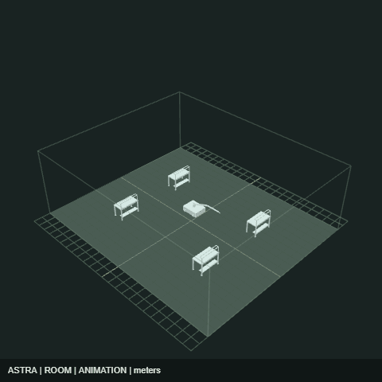
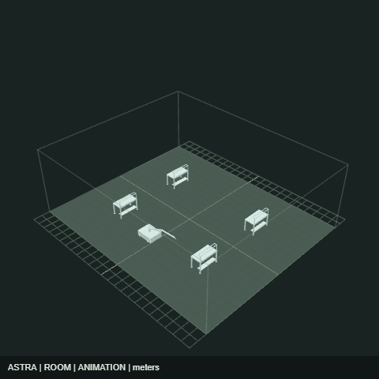
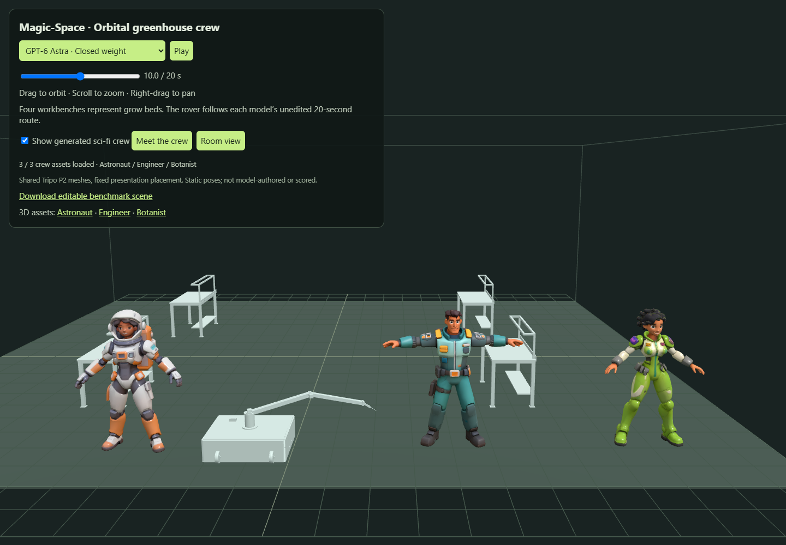

# Magic-Space

**Can an open-weight LLM generate an importable, animated 3D scene as reliably as a closed-weight model?** This hackathon prototype compares **DeepSeek-V4-Pro and GPT-6 Astra** through Comfy Cloud, validates their unedited JSON, and renders both in OpenIndustries. Three newly generated sci-fi people join the live viewer as a shared crew layer.

| DeepSeek-V4-Pro · open weight | GPT-6 Astra · closed weight |
| --- | --- |
|  |  |



[View the demo locally](#run-locally) · [Install OpenCode + Comfy MCP](#install-opencode--comfy-mcp) · [Run smoke tests](#smoke-tests)

## Why care?

**Generating an asset is only the beginning. Magic-Space explores how to bring it to life in a world.**

Stable Diffusion can generate visual concepts, and dedicated 3D-generation models can produce meshes. OpenIndustries adds a shared space: named objects, real-world placement, editable scene data, and authored motion. In this demo, the LLMs arrange existing geometry and animate a robot; **Tripo P2** generates the new astronaut, engineer, and botanist meshes.

For game designers, the next step is **persistent world context**: retain object identities, layout, roles, and previous decisions so a new generation can extend a world without losing continuity. The current prototype preserves a serialized scene and its animation; cross-generation continuity and autonomous behavior are future work.

## Hackathon checklist

- [x] Create and publish the GitHub repository.
- [x] Document how to run the codebase locally.
- [x] Run an open-weight vs. closed-weight model comparison.
- [x] Include GIFs and screenshots of sample outputs.
- [ ] Record a walkthrough video of the generation-to-world workflow.
- [ ] Add video clips of sample outputs alongside the GIFs.
- [ ] Carry world context across generations to help game designers maintain continuity.

## Tools used

| Tool | Role |
| --- | --- |
| **Comfy MCP** (`comfy-cloud`) | Run LLM workflows on Comfy Cloud and retrieve their outputs. The local `comfy-mcp` connection is optional and was not used for these generations. |
| **DeepSeek-V4-Pro — open-weight** | Generate scene layout and animation as JSON through Comfy's OpenRouter LLM node. Hosted inference; weights are not run locally. |
| **GPT-6 Astra — closed-weight** | Generate the comparison scene from the same prompt through the OpenAI ChatGPT node. |
| **Tripo P2** | Generate three textured sci-fi people as self-contained GLB assets through Comfy Cloud. |
| **OpenIndustries / its MCP scene contract** | Validate scene structure, resolve existing assets, import portable projects, and render animation. This run uses its schema and libraries directly; an autonomous OpenIndustries MCP tool loop is future work. |
| **OpenCode** | Coordinate model calls, write the adapter/evaluator, and package the demo. |
| **Playwright + Chrome** | Verify real browser imports and capture screenshots; GIFs use OpenIndustries’ renderer. |

## Run locally

### 1. Install prerequisites

- **Git** and **Node.js 22.14+** (including npm).
- A browser for the viewer. **Google Chrome** is required only for `npm run evaluate`.
- No local GPU, Python, ComfyUI installation, or API credentials are needed to view and evaluate the saved outputs.

### 2. Clone and install

Run these commands in a terminal. They work in PowerShell, macOS, and Linux shells. Keep both repositories in the same parent directory; the pinned OpenIndustries commit matches the recorded demo.

```sh
git clone https://github.com/Mapped-Assembly/OpenIndustries.git Open-Industries
cd Open-Industries
git checkout 5e306c2033bfdb15510f98f575f937e1578f6a3f
npm ci
cd ..
git clone https://github.com/isayahc/Magic-Space.git
cd Magic-Space
npm ci
npm start
```

### 3. Open the 3D space

Open **http://127.0.0.1:4194/comparison** and leave the terminal running.

- Switch between **DeepSeek-V4-Pro** and **GPT-6 Astra** using the dropdown. Qwen3 4B / GPT-4.1 remain available under Original baseline.
- Drag to orbit, scroll to zoom, and right-drag to pan.
- Pause or scrub the full 20-second robot animation.
- Click **Download editable scene** to import the project into OpenIndustries.
- Toggle **Show generated sci-fi crew**, or click **Meet the crew** for a closer look. Download each character using its GLB link.
- Press **Ctrl+C** in the terminal to stop the viewer.

On subsequent runs, open a terminal in `Magic-Space` and run `npm start`.

### Existing OpenIndustries checkout or occupied port

The default checkout path is `../Open-Industries`. Set `OI_ROOT` to use another location and optionally set `PORT` if 4194 is occupied.

**PowerShell:**

```powershell
$env:OI_ROOT = "C:\path\to\Open-Industries"
$env:PORT = "4196"
npm start
```

**macOS / Linux:**

```sh
OI_ROOT=/path/to/Open-Industries PORT=4196 npm start
```

With these examples, open `http://127.0.0.1:4196/comparison`. If dependencies are missing, run `npm ci` in both repositories. New model generations require a separate authenticated Comfy Cloud MCP connection; see [Repeat model generation](#repeat-model-generation-through-comfy-mcp).

## Install OpenCode + Comfy MCP

This is optional for viewing the saved scenes. Use it to connect an agent and create new workflows. Start in the **Magic-Space repository** with Node.js 22.14+ installed. The setup scripts do not require the OpenIndustries checkout.

### Linux and macOS

The same Bash script supports both platforms. It also requires `curl`.

```sh
bash scripts/setup.sh
```

### Windows

Run from PowerShell (no administrator shell required):

```powershell
powershell.exe -NoProfile -ExecutionPolicy Bypass -File .\scripts\setup.ps1
```

`-ExecutionPolicy Bypass` applies to this process only. The script does not change your machine's execution policy.

### What setup does

1. Reuses OpenCode V2 if installed, or installs it from the official V2 distribution. An existing V1 installation is reported rather than silently replaced.
2. Installs **both** the `comfy-cloud` connection and local `comfy-mcp` by default. Cloud-only and local-only modes are available below.
3. For local mode, reuses or installs `uv`, provisions Python 3.12 if needed, and installs `comfy-mcp==0.10.0` plus `comfy-cli==1.24.0` into `.magic-space/venv`.
4. Registers the connections using `opencode mcp add`, with absolute executable paths and `COMFY_BIN` for the local server. Configuration is scoped to **this checkout**, not your global OpenCode config.
5. Saves machine-local paths in `.magic-space/setup.json`. That directory and the generated `opencode.json(c)` are ignored by Git. Existing project config is backed up there before the CLI merges the Comfy entries; unrelated entries are preserved.

The scripts can be rerun. They do not remove a previously configured connection when you select a different mode. If you move the repository, rerun setup to update its absolute paths. They install the MCP bridge, **not ComfyUI, model weights, or GPU drivers**, and do not start generation jobs. No system-wide Python packages are changed. On Windows the downloaded OpenCode executable is kept under your home directory and launched through `npm run agent`; no permanent PATH change is needed.

### Choose cloud or local

**Cloud only** (no Python/uv/local MCP installation):

```sh
# Linux / macOS
bash scripts/setup.sh --mode cloud
```

```powershell
# Windows
powershell.exe -NoProfile -ExecutionPolicy Bypass -File .\scripts\setup.ps1 -Mode cloud
```

**Local only**, optionally selecting an existing ComfyUI workspace:

```sh
# Linux / macOS
bash scripts/setup.sh --mode local --workspace /path/to/ComfyUI
```

```powershell
# Windows
powershell.exe -NoProfile -ExecutionPolicy Bypass -File .\scripts\setup.ps1 -Mode local -Workspace "C:\path\to\ComfyUI"
```

The workspace must contain `main.py`. Omit the workspace argument to keep the current comfy-cli default; supplying it runs `comfy set-default`, which changes **comfy-cli's user-level default workspace**. Use `both` instead of `local` to configure both connections with a workspace.

### Sign in and open the agent

```sh
npm run agent
```

- Use **`/connect`** to select an OpenCode agent model/provider. This is separate from Comfy authentication.
- For Comfy Cloud, use **`/mcps` → `comfy-cloud` → sign in** and finish OAuth in your browser. Setup registers the connection but cannot complete sign-in for you.
- The local MCP connection itself needs no Cloud sign-in. Local workflow execution requires a running ComfyUI; paid partner nodes have separate authentication requirements.

OpenCode V2 loads configuration changes automatically. Use `/reload` if a manual refresh is needed.

## Smoke tests

After setup and, for cloud mode, sign-in:

```sh
npm run smoke
```

This checks OpenCode V2, initializes the checkout's MCP connections through `opencode mcp list`, then reads their structured status. It requires every connection selected during setup to report **connected**; unrelated MCP failures do not affect the result. Initial discovery and pending startup are retried for up to 60 seconds. Missing configuration, authentication-required, and failed connections produce a nonzero exit code with next steps.

The test uses **no LLM calls or generation credits**. A connected local MCP proves the bridge initialized; it does not prove that ComfyUI or a model can execute a workflow.

```sh
# Test just one connection
node scripts/smoke.mjs --mode cloud
node scripts/smoke.mjs --mode local

# Also check a running local ComfyUI's read-only /system_stats endpoint
node scripts/smoke.mjs --mode local --require-comfyui

# If your local ComfyUI uses another port
node scripts/smoke.mjs --mode local --require-comfyui --comfyui-url http://127.0.0.1:8000

# Offline fixture smoke test: no installation or sign-in needed
node scripts/smoke.mjs --offline

# Regression tests for status handling, argument passing, and saved outputs
npm test
```

The offline check verifies the saved scene objects, timeline duration, and identical workflow prompts. For full schema validation, actual browser imports, and GIF rendering, use `npm run evaluate` as described below.

[Cross-platform CI](https://github.com/isayahc/Magic-Space/actions/workflows/smoke.yml) runs regression tests, offline checks, installer syntax checks, fresh local MCP setup, and the OpenCode/local-MCP handshake on Linux, macOS, and Windows. Cloud OAuth and GPU generation are user-run checks, not CI requirements.

Setup sources: [OpenCode V2 installation](https://opencode.ai/v2/docs/), [OpenCode MCP configuration](https://opencode.ai/v2/docs/mcp-servers), [Comfy MCP guide](https://docs.comfy.org/agent-tools/mcp), and [uv installer](https://docs.astral.sh/uv/reference/installer/).

## Results and methodology

Both current models ran on Comfy Cloud with the exact same prompt (`prompt.txt`). No model answer was repaired. One task and one sample per model: this demonstrates the pipeline, not a general model ranking or autonomous tool calling.

| Result | DeepSeek-V4-Pro (open weight) | GPT-6 Astra (closed weight) |
| --- | --- | --- |
| Strict JSON and OpenIndustries schema | Pass | Pass |
| Structural/task checks including portable roundtrip | 13/13 | 13/13 |
| Browser import | 5 objects, no missing geometry | 5 objects, no missing geometry |
| Compact JSON instruction | Followed | Followed |
| Robot Z path at 0/5/10/15/20 seconds | -4, 4, -4, 4, -4 | -4, 0, 4, 0, -4 |
| Segment speed | 1.6 m/s throughout | 0.8 m/s throughout |

DeepSeek uses `OpenRouterLLMNode`, model `deepseek/deepseek-v4-pro`, high reasoning effort, seed 0 (omitted by the provider wrapper). GPT uses `OpenAIChatNode`, model `gpt-6-astra`, high reasoning effort, truncation disabled, and a 16,384-token cap including reasoning. OpenRouter's node exposes no matching output-token cap, so budgets are **not controlled equally**. Provider sampling defaults apply. The historical `/no_think` suffix is retained identically in both prompts for task continuity; it is not evidence that either provider disabled reasoning. These wrappers are different inference implementations.

Both satisfy the required endpoints, aisle, and loop. DeepSeek makes two round trips while GPT makes one; the prompt did not require exactly one round trip. Constant speed was not requested. Neither result is a physical-control or collision certification. Names/creativity are qualitative observations, not part of the 13 checks.

### Original baseline

The earlier Qwen3 4B / GPT-4.1 results and media remain available, with checks in `assets/legacy-results.json`. Both passed 13/13 checks. Their original settings used 4096-token caps; Qwen used `TextGenerate` with sampling off and thinking false. Re-evaluate them with `node --import tsx evaluate.mjs --legacy`.

## Generated sci-fi people

Three textured **Tripo P2** assets are included: [astronaut](assets/astronaut.glb), [engineer](assets/engineer.glb), and [botanist](assets/botanist.glb). Each generation requested a 12,000-face budget and a relaxed A-pose. The GLBs contain their geometry and textures, and can be opened in a GLB-compatible tool such as Blender.

The viewer normalizes each character to 1.75 m and places the same crew beside either model's farm. This is a **presentation layer**, not LLM-authored placement, and is excluded from the 13 benchmark checks and benchmark-scene download. Characters are static meshes, not rigged walking agents. The GIFs above show the benchmark alone; `assets/*.crew.png` and `assets/sci-fi-crew.png` show the crew layer.

`assets/provenance.json` records job IDs and placement. `assets/crew-batch.json` preserves exact prompts, seeds, and template overrides. Regenerate these recipe files with `node scripts/crew-workflows.mjs` (no spend). To generate new meshes, submit its three items through Comfy Cloud's `submit_batch` after approving credit spend; verify template addresses with `get_template_schema` if the upstream template changes.

## Artifacts

All generated assets and recorded results live in `assets/`. Source scripts, the shared `prompt.txt`, and documentation live at the repository root.

- `assets/*.raw.txt`: original unedited answers.
- `assets/*.scene.json`: portable scene with existing example geometry bundled by a deterministic adapter. Open in OpenIndustries using Import project. The adapter maps field names and adds track/key IDs without changing model choices.
- `assets/*.png`: browser screenshots, including model imports, crew views, and the mobile viewer.
- `assets/*.gif`: native OpenIndustries authored-animation render, 480×480, 40 frames at 10 fps. These show **seconds 8–12** of the original 20-second timeline, because the native GIF renderer limits each clip to four seconds. They are not full-loop exports.
- `assets/*.gif-metadata.json`: exact per-frame world poses and provenance.
- `assets/*.workflow-api.json`: reproducible LLM workflow graphs.
- `assets/results.json`: individual checks, job IDs, speeds, and browser evidence.
- `assets/legacy-results.json`: preserved Qwen3 4B / GPT-4.1 baseline results.
- `assets/*.glb`: generated crew meshes; `assets/provenance.json` and `assets/crew-batch.json` document their origin and recipe.
- `assets/viewer-verification.json`: browser checks for crew loading, model switching, scrubbing, and desktop/mobile layouts.
- `evaluate.mjs`: reruns validation, portable conversion, browser import, and GIF capture without making paid model calls.

The pinned OpenIndustries checkout retains legacy `astra.scene` serialization and Mergence UI branding. Its supported parser and scene contract were used directly. The farm is a planning layout: existing cleanroom desks stand in for grow beds, and the bundled robot is reused. The LLMs generated the scene arrangement/animation; Tripo generated the separate crew geometry. See [source attribution and geometry notices](PROVENANCE.md).

## Reproduce validation and rendering

Google Chrome must be installed for the browser checks. From this repository:

```sh
npm run evaluate
```

This validates the saved answers, regenerates the portable scenes, imports each in a fresh browser, and exports screenshots/GIFs. It starts a temporary local Vite server on port 4195 and shuts it down when finished. It does not call a model or spend credits.

With `npm start` running in another terminal, run `node scripts/verify-viewer.mjs` to check both current models, actual crew GLB loading, scrubbing, toggling, and desktop/mobile layouts. Set `VIEWER_URL` if using a different port. This writes crew screenshots and `viewer-verification.json` into `assets/`. Restart `npm start` after editing `viewer.html` so Vite refreshes its inline-module cache.

## Repeat model generation through Comfy MCP

`npm run workflows` regenerates current and legacy `assets/*.workflow-api.json` files from the shared prompt. For the current comparison, submit **`assets/deepseek-v4-pro.workflow-api.json` and `assets/gpt-6-astra.workflow-api.json`** as two `submit_batch` items with `tool: "submit_workflow"`. These are API-format graphs, not editor drag-and-drop files. They correspond to the node graphs used in this run. Both use `SaveText` to preserve the raw answer. Submit through an authenticated Comfy Cloud MCP connection, wait for the jobs, and download their outputs. New generations consume Comfy credits.

To evaluate a new run, replace the corresponding `assets/*.raw.txt` files and update the job identifiers in `models.mjs`, then rerun the evaluator. Keep separate copies for multiple trials. The recorded run is a single-sample smoke test, not a statistical benchmark.

The two current LLM jobs and three character-generation jobs have completed. Their IDs are in `assets/results.json` and `assets/provenance.json`. No provider keys or signed download URLs are stored here.
